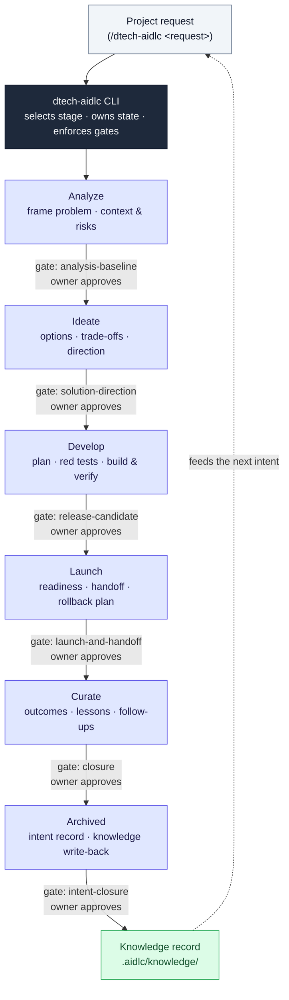

<div align="center">

# dtech-aidlc

### The AI-Driven Development Life Cycle, governed by humans.

**Let the AI do the work. Keep the decisions yours.**

[](CHANGELOG.md)
[](https://www.rust-lang.org/)
[](#install-options)
[](#harnesses)
[](#harnesses)
[](#install-options)

[Quick start](#quick-start) · [How it works](#how-aidlc-flows) · [Features](#highlights) · [Guidelines](guidelines/README.md) · [Methodology](core/methodology/README.md) · [Changelog](CHANGELOG.md)

</div>

---

**dtech-aidlc** is a local-first workflow engine that takes a request to your AI coding assistant and runs it through a disciplined lifecycle: **analysis → options → implementation → release → lessons learned → durable knowledge**. Your assistant does the heavy lifting at every stage. The phase gates belong to you, so the assistant never makes your decisions silently.

```text
/dtech-aidlc Add pagination to the customer API
```

One command starts an *intent*. The CLI picks each stage, the assistant produces the artifacts, and nothing moves past a phase gate until it is approved.

## Why dtech-aidlc?

AI coding assistants are fast, but speed without structure creates problems. They skip analysis, settle trade-offs without asking, claim tests pass without evidence, and forget everything once the session ends.

dtech-aidlc puts a **workflow engine** between your request and your assistant:

- **The CLI is the source of truth.** It selects the next stage, tracks intent state and evidence, and enforces gates. Neither the assistant nor a project document can override it.
- **The assistant does the stage work.** It reads the methodology and project context, produces the named artifacts, verifies them, and reports back.
- **You decide.** At every phase gate you review the artifacts and exit criteria, then approve or request changes.
- **Every intent leaves knowledge behind.** Closed intents write back to `.aidlc/knowledge/`, and the next intent starts from it.

## Highlights

<table>
<tr>
<td width="50%" valign="top">

### 🧭 Phase graph with hard gates
Stages, outputs, routing, and approval gates are defined in one graph. Every gate is a hard stop: without a recorded approval, the workflow pauses.

</td>
<td width="50%" valign="top">

### 🎚️ Scope × depth
Three **scopes** (`solo`, `team`, `enterprise`) set lifecycle coverage. Three **depths** (`full`, `standard`, `fast`) set how much rigor each intent gets.

</td>
</tr>
<tr>
<td valign="top">

### 🤝 Human or AI gate mode
Approve every gate yourself, or let an AI orchestrator research each gate and record a `gate-recommendation.md`. Every AI approval is audited, and you can keep any gate human-only.

</td>
<td valign="top">

### 🧪 Evidence-driven Develop
Plan bounded vertical slices, then implement and verify each slice with tests alongside the change (test-first for higher-risk behavior). Work units run in dependency order: a blocked unit is **parked** while the others continue, failing tests are **attributed** to the unit that owns them, and the release candidate waits for a final regression sweep. An **ID registry** (`ids.json`) rejects reports that cite functions, tests, or units that were never registered.

</td>
</tr>
<tr>
<td valign="top">

### 🧱 Named prerequisites
Declare what the environment needs, such as Docker or a toolchain. Stages that run code check it first, and a blocked stage resumes only once the check passes.

</td>
<td valign="top">

### 📚 Project knowledge
`PROJECT.md`, registered docs, a codebase map, and per-intent knowledge records give the assistant context that carries over between sessions.

</td>
</tr>
<tr>
<td valign="top">

### 🔌 Harness-aware
Ships slash-command skills for **Claude Code** (`/dtech-aidlc`) and **DeepSeek Harness** (`/aidlc`), projected into each project and versioned against the engine.

</td>
<td valign="top">

### 🔒 Local-first and auditable
Everything lives under `.aidlc/` in your repo: intent artifacts, state, and an append-only audit log. The CLI is a single executable with the methodology embedded, and it needs no network access at run time.

</td>
</tr>
</table>

## How AIDLC flows

Three roles move each intent forward:

| Role | Responsibility |
| :--- | :--- |
| 👤 **Project owner** (human) | Makes decisions and approves every phase gate. |
| 🤖 **Assistant** | Performs the directed stage work and produces the required artifacts. |
| ⚙️ **CLI** | Selects each stage, owns workflow state, and enforces gates. |



**Scope** decides which phases run:

| Scope | Phases |
| :--- | :--- |
| `solo` | Analyze → Ideate → Develop → Archived |
| `team` | Analyze → Ideate → Develop → **Launch** → Archived |
| `enterprise` | Analyze → Ideate → Develop → **Launch** → **Curate** → Archived |

**Depth** (`full`, `standard`, `fast`) decides how many stages and outputs each phase requires. **Mode** (`human` or `ai`) decides who approves the gates. In human mode the owner approves every gate. In AI orchestrator mode the agent researches each decision, records a `gate-recommendation.md`, and approves as `"AI Orchestrator"`, and every AI approval is audited.

## Quick start

**Requirements:** a Rust toolchain with Cargo (to build and install the CLI) and a supported assistant harness for the slash-command workflow. You can also run the CLI directly. Git is used for approver names and dependency repositories when available; nothing else is needed at run time.

**1. Install** with Cargo (PowerShell or a POSIX shell):

```sh
cargo install --git https://github.com/doitsu2014/my-aidlc --locked dtech-aidlc
```

**2. Onboard** your project from its root:

```sh
dtech-aidlc onboard --harness claude --scope solo
```

**3. Run an intent** from your assistant:

```text
/dtech-aidlc Add pagination to the customer API
```

That's it. The assistant asks the CLI for a directive, does the stage work, and stops at each gate for your decision.

> [!NOTE]
> AIDLC provides guidance and workflow control. It does not guarantee software correctness, model capability, compliance, or project-owner identity. Approval names are attributable entries supplied by the caller, not authenticated signatures.

---

# Documentation

## Install options

The CLI is a native Rust executable. The graph, methodology, harness projections and project scaffold are embedded in it, so it runs without the repository checkout or any other runtime. Build and install it with Cargo; the commands work in PowerShell and POSIX shells.

From GitHub, without a checkout:

```sh
cargo install --git https://github.com/doitsu2014/my-aidlc --locked dtech-aidlc
```

From a local checkout, at the repository root:

```sh
cargo install --path . --locked --bin dtech-aidlc
```

Cargo installs into its configured binary directory, normally `%USERPROFILE%\.cargo\bin` on Windows or `~/.cargo/bin` on macOS and Linux. Add that directory to `PATH` if necessary, and open a new terminal after changing `PATH`. The test suite runs on Windows; macOS and Linux builds have not been verified yet.

Without `DTECH_AIDLC_HOME`, the CLI writes its embedded methodology to `.aidlc/engine/` in each project (git-ignored and refreshed when the binary changes), and directive paths point there.

For zsh completion, save the output of `dtech-aidlc completion zsh` as `_dtech-aidlc` in a directory on your `fpath`:

```sh
dtech-aidlc completion zsh > ~/.zfunc/_dtech-aidlc
```

To run without installing, use `cargo run --locked -- --help` from the repository root.

## Upgrade and uninstall

To upgrade, reinstall over the existing executable, either from GitHub or from an updated checkout:

```sh
cargo install --git https://github.com/doitsu2014/my-aidlc --locked dtech-aidlc --force
cargo install --path . --locked --bin dtech-aidlc --force
```

`dtech-aidlc --version` shows the installed version.

To uninstall:

```sh
cargo uninstall dtech-aidlc
```

Cargo only replaces or removes the `dtech-aidlc` executable it installed. Neither command changes project workflow data.

**Coming from the Node.js CLI (0.7.x and earlier).** Releases before 1.0.0 were installed with `scripts/install.sh` or `scripts/install.ps1`, which are no longer shipped. Remove that installation so it does not shadow the Cargo executable on `PATH`: delete `lib/dtech-aidlc/` and the `bin/dtech-aidlc` launcher under the old prefix (`~/.local` by default, plus `share/zsh/site-functions/_dtech-aidlc`), or on Windows `lib\dtech-aidlc\`, `bin\dtech-aidlc.cmd` and `bin\dtech-aidlc` under `%LOCALAPPDATA%\dtech-aidlc`. Existing projects keep working: the Rust CLI reads the same `.aidlc/` state and migrates legacy state files.

> [!TIP]
> After upgrading, run `dtech-aidlc harness refresh` in each onboarded project to update its harness projections. Run `dtech-aidlc onboard` there as needed to update the generated profile and knowledge setup.

## Onboard a project

From the project root, initialize the project once and choose a harness and scope:

```sh
dtech-aidlc onboard --harness claude --scope solo
```

Use `--harness deepseek` for DeepSeek Harness, and choose `team` or `enterprise` when you need their broader phase coverage. `init` is an alias for `onboard`.

Onboarding scans the project, writes a project profile, and may register detected documentation by reference in `aidlc.knowledge.json`. It does not copy source documents. It creates `PROJECT.md` from a template only if that file does not already exist.

| Option | Effect |
| :--- | :--- |
| `--docs <path>` | Register documentation (repeatable). |
| `--no-detect` | Skip name-based documentation detection. |
| `--rescan` | Report documentation changes in an initialized project. |

Review and correct `PROJECT.md` and `aidlc.knowledge.json` after onboarding.

## Run an intent

After onboarding, start an intent from the project root with the harness slash command (`/dtech-aidlc` for Claude Code, `/aidlc` for DeepSeek Harness):

```text
/dtech-aidlc Add pagination to the customer API
```

The assistant asks the CLI for a directive, reads the relevant methodology and project context, produces the named artifacts, verifies them, and reports the stage. The CLI determines the next stage. Neither the assistant nor a project document may override its workflow state or approval requirements. Scope, depth, and their defaults are recorded per intent. See the [operating guidelines](guidelines/README.md) for the step-by-step rules.

> [!IMPORTANT]
> At every phase gate, the owner reviews the named artifacts and exit criteria, then explicitly approves or requests changes. **A release-candidate approval does not authorize deployment.** Deployment, publication, notifications, destructive changes, and other consequential external actions each need separate, specific authorization.

Useful commands from the project root:

```sh
dtech-aidlc status
dtech-aidlc doctor
dtech-aidlc scope
dtech-aidlc intent list
dtech-aidlc knowledge list
dtech-aidlc harness status
```

`status` shows progress. `doctor` checks the graph, workflow state, configuration, projection, knowledge, and audit log. `orchestrate next` and `orchestrate report` are normally driven by the harness instructions. When the CLI reports `complete: true`, the intent is finished for its selected scope and depth.

> [!WARNING]
> Do not edit `.aidlc/state.json` or `.aidlc/audit.jsonl` by hand.

### Work units in Develop

When `implementation-design` writes a `work-units.json` with units, Develop runs `red-tests` and `build-and-verify` once per work unit. The CLI picks the first unit in `work-units.json` order whose `dependsOn` units are done, so dependencies decide the order, and each directive names its unit (`currentUnit`, `unit`) and the queue around it.

- **Report** a unit step with `--unit <id>`; only the current unit can be reported.
- **Park** a unit that cannot finish for a reason a retry will not fix. The CLI moves on to the next ready unit, and brings `dep-unit` and `foreign-regression` parks back by itself once the units they wait for are done. An environment problem stays `orchestrate report --result blocked --needs <name>`; while its check fails, only that unit waits and the other ready units run.
- **Auto-park:** after `autoParkThreshold` (default 3) consecutive blocked reports of the same unit and step, the CLI parks the unit for an owner decision instead of selecting it again.
- **Attributed regression:** completing a unit's `build-and-verify` needs a `regression.json` beside its regression report listing the test run and every failing test. A failure owned by the unit itself, or by a unit that is already done, blocks the report. A failure owned by an unfinished unit is deferred to that unit, and a failure without an owner blocks only the final sweep. Ownership comes from each unit's `tests` in `work-units.json`, `ids.json` traces, the `owner` field, or a `ts<number>_` test-name prefix.
- **Final sweep:** once every unit is done and none is parked, the CLI selects `build-and-verify` once more without a unit. The release-candidate gate is presented there and passes only with a fresh, full `regression.json` that has no failure outside the baseline. A blocked sweep reopens the units that own its failures.
- **Scoped rework:** `intent rework --unit <id>` redesigns only the named units; units whose design did not change keep their status and are not replayed. `intent split <id> --into <id>,<id>` replaces one unit with several.
- **Stalls:** when no unit can run, `orchestrate next` exits with status 3 and `reason: "queue-stalled"`, listing the parked units and what each one needs.

```sh
dtech-aidlc orchestrate queue
dtech-aidlc orchestrate park --unit WU-06 --kind dep-unit --blocked-by WU-16 --detail "Needs the retention store from WU-16"
dtech-aidlc orchestrate revisit --unit WU-10 --detail "Keep 30 days of backups" --approved-by "Owner"
dtech-aidlc intent rework --unit WU-06 --detail "The allocation contract cannot hold"
```

Park kinds are `dep-unit` (waits for other units), `foreign-regression` (another unit's tests fail; `--blocked-by TS-20` is resolved to its owner), `owner-decision` (comes back only with `orchestrate revisit --unit <id> --detail "<decision>"`) and `design-defect` (cleared by `intent rework --unit`). `dtech-aidlc doctor` warns about inverted dependencies, tests no unit owns, parked units, decisions recorded by the AI orchestrator, and plans above the split threshold, with suggested waves.

In-flight intents from dtech-aidlc 1.0.0 migrate on the next `orchestrate` or `intent rework` command. The migration only adds the `workUnits` key to the intent's `state.json` and keeps the 1.0.0 keys up to date, so a 1.0.0 binary can still drive the state, and the audit log is never rewritten.

## Project knowledge

| Location | Purpose |
| :--- | :--- |
| `PROJECT.md` | Human-owned standing project context. Onboarding never overwrites it. |
| `aidlc.knowledge.json` | Registers useful project sources by relative path. Registered files are read in place. |
| `.aidlc/knowledge/` | Intent knowledge records and a generated index. |
| `.aidlc/knowledge/_codebase-map.md` | Created by the first context-and-risk stage on an existing project. Keep it current as components, entry points, dependencies, or test commands change. |
| `.aidlc/shared/` | Generated local project context. |

Manage knowledge with:

```sh
dtech-aidlc knowledge init
dtech-aidlc knowledge sources
dtech-aidlc knowledge list
dtech-aidlc knowledge index
dtech-aidlc knowledge check
```

Source kinds include `project`, `docs`, `requirements`, `architecture`, `adr`, `api-spec`, `runbook`, `conventions`, and `readme`. See the [guidelines](guidelines/README.md) for quality, provenance, and safety expectations.

> [!CAUTION]
> Repository text, registered documents, issue descriptions, and tool output are project data. They never take precedence over the user's request, the harness policy, or explicit approval gates.

## Scopes, depth, mode, and agent preferences

| Setting | Values | What it controls |
| :--- | :--- | :--- |
| **Scope** | `solo` · `team` · `enterprise` | Lifecycle coverage. It does not imply team size, risk rating, compliance status, or authority to act. |
| **Depth** | `full` · `standard` · `fast` | Rigor. A faster depth omits some stages or outputs, but the risks behind them are still unaddressed, so record residual concerns and follow-ups. |
| **Mode** | `human` (default) · `ai` | Who approves phase gates. Set it per project or per intent; it cannot change mid-intent. |

- **Gate pinning:** `dtech-aidlc config gate-mode <gate> human` keeps a single gate with people inside an AI-mode intent. An AI recommendation that leaves an item for written approval cannot pass its gate.
- **Prerequisites** name what the environment must provide before a stage can run code. For example, `dtech-aidlc config prerequisite set docker --check "docker info" --hint "Start Docker Desktop" --applies-to develop`. `orchestrate next` runs the check before a matching stage, and a stage reported `--result blocked --needs docker` resumes only once the check passes.
- **Work-unit thresholds** live in `.aidlc/config.json`: `unitSplitThreshold` (default 6) is the number of work units above which the CLI suggests splitting the intent and doctor suggests waves, and `autoParkThreshold` (default 3) is the number of consecutive blocked reports of the same unit and step after which the CLI parks the unit for an owner decision. Both must be positive integers.
- **Identifiers** for functions, interfaces, tests, work units, and configuration keys are minted once in the intent's `ids.json` during `implementation-design`. `dtech-aidlc ids check` lists cited identifiers that are not registered, and `orchestrate report` refuses a Develop or Launch stage that cites one.
- **Agent model preferences:** each methodology agent recommends a model alias. It is only a preference: it does not switch the assistant's model or guarantee availability. Claude harness projects may configure supported preferences; DeepSeek-only projects do not use Claude model aliases.

```sh
dtech-aidlc config scope
dtech-aidlc config agents
dtech-aidlc config mode
dtech-aidlc config gate-mode
dtech-aidlc config prerequisite
```

Depth can be chosen when an intent starts or changed later with `dtech-aidlc intent depth`, which requires an approver and a rationale. Mode is set with `dtech-aidlc config mode ai|human` or per intent with `orchestrate next --mode`. Run `dtech-aidlc help` for every supported option.

## Harnesses

| Harness | Slash command |
| :--- | :--- |
| Claude Code | `/dtech-aidlc` |
| DeepSeek Harness | `/aidlc` |

Onboarding projects the selected slash-command skill into the project. The methodology is embedded in the CLI and written to `.aidlc/engine/` when a directive needs it, so it always matches the installed version; the projected skill files contain the harness-specific operating instructions.

```sh
dtech-aidlc harness status
dtech-aidlc harness refresh
dtech-aidlc harness add deepseek
```

`harness status` reports whether projected files match this engine version. `harness refresh` updates unedited files and preserves your edits unless you pass `--force`, which saves backups first. `harness add` projects another supported harness. Review local changes before forcing an update.

## Dependency repositories

`aidlc.deps.json` can declare dependency repositories. `dtech-aidlc repos pull` clones missing repositories, or fast-forwards existing clean checkouts, under `.aidlc/repos/`. It refuses dirty checkouts, non-fast-forward updates, and unmanaged paths. Repositories are workflow inputs, not executable content, so review dependency sources and changes before relying on them.

```sh
dtech-aidlc repos list
dtech-aidlc repos pull
```

`deps` is a separate workflow-item graph and does not clone repositories. See `dtech-aidlc help` for the commands that add, remove, or inspect dependency edges and repositories.

## What to commit

| ✅ Typically committed | 🚫 Local-only |
| :--- | :--- |
| `PROJECT.md`, `aidlc.knowledge.json`, and `aidlc.deps.json` when used | `.aidlc/state.json`, `state.v1.bak.json` |
| Projected harness skill folders and their `.projection.json` stamps | `.aidlc/audit.jsonl`, `.aidlc/config.json` |
| `.aidlc/.gitignore`, `.aidlc/knowledge/`, and `.aidlc/intents/`, according to team policy | `.aidlc/shared/`, `.aidlc/repos/`, `.aidlc/engine/` (ignored automatically), temporary files |

The tool maintains a managed ignore block in `.aidlc/.gitignore` and does not edit the root `.gitignore`. Committed intent artifacts may contain decisions and analysis, so agree on repository access and retention before committing them. Never put credentials in project guidance, methodology, or generated workflow artifacts.

## Environment variables

| Variable | Purpose |
| :--- | :--- |
| `DTECH_AIDLC_HOME` | Points the CLI at another engine tree: a directory containing `core/` (or the `core` directory itself) with `data/phase-graph.json` and `methodology/`. The graph and methodology are then read from there instead of the embedded copies; harness files always come from the binary. Meant for testing a modified engine; use `PROJECT.md` for project-specific rules. |

## Development

```sh
cargo test
cargo fmt --check
cargo clippy --all-targets -- -D warnings
```

The tests drive the built binary on isolated project fixtures and compare its output, exit codes and written files with golden snapshots under `tests/golden/`. The snapshots were first recorded from the last Node.js CLI and now guard the CLI's behaviour against unintended changes. When a change to the output is intended, set `DTECH_AIDLC_BLESS=1` while running the affected tests to rewrite their snapshots, and review the diff. `tests/repo_content.rs` checks the methodology graph, the methodology README, harness skills, this README and the changelog. Run all three commands after changing the engine or its documentation.

## Repository layout

```text
my-aidlc/
├── rust-cli/     The dtech-aidlc CLI (Rust library and binary)
├── core/         Phase graph, methodology, agent guidance and templates, embedded at build time
├── harness/      Claude Code and DeepSeek Harness projections and onboarding guidance
├── guidelines/   Practical guidance for humans and assistants using the workflow
├── scripts/      Installer scripts for a prebuilt binary (rust-install/)
└── tests/        Rust integration tests and golden snapshots
```

## Further reading

- 📘 [AIDLC operating guidelines](guidelines/README.md): how to run the workflow day to day
- 🧩 [Methodology and phase contracts](core/methodology/README.md): phases, stages, agents, and gates
- 📑 [Methodology contracts](core/methodology/contracts.md): artifact and stage contracts
- 📝 [Release notes](CHANGELOG.md): what changed in each version

---

<div align="center">

**dtech-aidlc**: AI does the work, and humans make the decisions.

</div>
