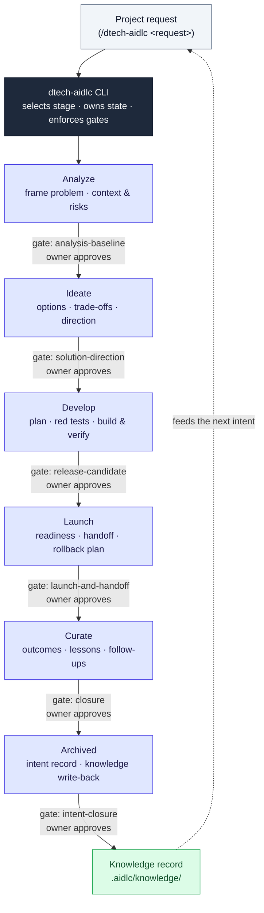

<div align="center">

# dtech-aidlc

### The AI-Driven Development Life Cycle, governed by humans.

**Let the AI do the work. Keep the decisions yours.**

[](CHANGELOG.md)
[](https://nodejs.org/)
[](#quick-start)
[](#harnesses)
[](#harnesses)
[](#install-options)

[Quick start](#quick-start) · [How it works](#how-aidlc-flows) · [Features](#highlights) · [Guidelines](guidelines/README.md) · [Methodology](core/methodology/README.md) · [Changelog](CHANGELOG.md)

</div>

---

**dtech-aidlc** is a local-first workflow engine that takes a request to your AI coding assistant and runs it through a disciplined lifecycle: **analysis → options → implementation → release → lessons learned → durable knowledge**. Your assistant does the heavy lifting at every stage. The phase gates belong to you, so the assistant never makes your decisions silently.

```text
/dtech-aidlc Add pagination to the customer API
```

One command starts an *intent*. The CLI picks each stage, the assistant produces the artifacts, and nothing moves past a phase gate until it is approved.

## Why dtech-aidlc?

AI coding assistants are fast, but speed without structure creates problems. They skip analysis, settle trade-offs without asking, claim tests pass without evidence, and forget everything once the session ends.

dtech-aidlc puts a **workflow engine** between your request and your assistant:

- **The CLI is the source of truth.** It selects the next stage, tracks intent state and evidence, and enforces gates. Neither the assistant nor a project document can override it.
- **The assistant does the stage work.** It reads the methodology and project context, produces the named artifacts, verifies them, and reports back.
- **You decide.** At every phase gate you review the artifacts and exit criteria, then approve or request changes.
- **Every intent leaves knowledge behind.** Closed intents write back to `.aidlc/knowledge/`, and the next intent starts from it.

## Highlights

<table>
<tr>
<td width="50%" valign="top">

### 🧭 Phase graph with hard gates
Stages, outputs, routing, and approval gates are defined in one graph. Every gate is a hard stop: without a recorded approval, the workflow pauses.

</td>
<td width="50%" valign="top">

### 🎚️ Scope × depth
Three **scopes** (`solo`, `team`, `enterprise`) set lifecycle coverage. Three **depths** (`full`, `standard`, `fast`) set how much rigor each intent gets.

</td>
</tr>
<tr>
<td valign="top">

### 🤝 Human or AI gate mode
Approve every gate yourself, or let an AI orchestrator research each gate and record a `gate-recommendation.md`. Every AI approval is audited, and you can keep any gate human-only.

</td>
<td valign="top">

### 🧪 Evidence-driven Develop
A plan, then red tests, then build and verify, run for each work unit. An **ID registry** (`ids.json`) rejects reports that cite functions, tests, or units that were never registered.

</td>
</tr>
<tr>
<td valign="top">

### 🧱 Named prerequisites
Declare what the environment needs, such as Docker or a toolchain. Stages that run code check it first, and a blocked stage resumes only once the check passes.

</td>
<td valign="top">

### 📚 Project knowledge
`PROJECT.md`, registered docs, a codebase map, and per-intent knowledge records give the assistant context that carries over between sessions.

</td>
</tr>
<tr>
<td valign="top">

### 🔌 Harness-aware
Ships slash-command skills for **Claude Code** (`/dtech-aidlc`) and **DeepSeek Harness** (`/aidlc`), projected into each project and versioned against the engine.

</td>
<td valign="top">

### 🔒 Local-first and auditable
Everything lives under `.aidlc/` in your repo: intent artifacts, state, and an append-only audit log. The installer needs no network access.

</td>
</tr>
</table>

## How AIDLC flows

Three roles move each intent forward:

| Role | Responsibility |
| :--- | :--- |
| 👤 **Project owner** (human) | Makes decisions and approves every phase gate. |
| 🤖 **Assistant** | Performs the directed stage work and produces the required artifacts. |
| ⚙️ **CLI** | Selects each stage, owns workflow state, and enforces gates. |



**Scope** decides which phases run:

| Scope | Phases |
| :--- | :--- |
| `solo` | Analyze → Ideate → Develop → Archived |
| `team` | Analyze → Ideate → Develop → **Launch** → Archived |
| `enterprise` | Analyze → Ideate → Develop → **Launch** → **Curate** → Archived |

**Depth** (`full`, `standard`, `fast`) decides how many stages and outputs each phase requires. **Mode** (`human` or `ai`) decides who approves the gates. In human mode the owner approves every gate. In AI orchestrator mode the agent researches each decision, records a `gate-recommendation.md`, and approves as `"AI Orchestrator"`, and every AI approval is audited.

## Quick start

**Requirements:** Node.js 20 or newer, PowerShell (Windows) or a POSIX shell (macOS/Linux), and a supported assistant harness for the slash-command workflow. You can also run the CLI directly.

**1. Install** from the repository checkout:

```powershell
pwsh -File scripts/install.ps1   # Windows (PowerShell 7 recommended)
```

```sh
sh scripts/install.sh
```

**2. Onboard** your project from its root:

```sh
dtech-aidlc onboard --harness claude --scope solo
```

**3. Run an intent** from your assistant:

```text
/dtech-aidlc Add pagination to the customer API
```

That's it. The assistant asks the CLI for a directive, does the stage work, and stops at each gate for your decision.

> [!NOTE]
> AIDLC provides guidance and workflow control. It does not guarantee software correctness, model capability, compliance, or project-owner identity. Approval names are attributable entries supplied by the caller, not authenticated signatures.

---

# Documentation

## Install options

The installer works entirely from the repository checkout and needs no network access.

| | Windows | macOS / Linux |
| :--- | :--- | :--- |
| **Default prefix** | `%LOCALAPPDATA%\dtech-aidlc` | `~/.local` |
| **CLI library** | `lib/dtech-aidlc/` | `lib/dtech-aidlc/` |
| **Launchers** | `bin/` | `bin/` |
| **Shell completion** | — | zsh, under `share/zsh/site-functions/` |

Add the install `bin` directory to `PATH` if necessary. On Windows, open a new terminal after changing `PATH` or enabling a Node.js installation managed by nvm. The CLI needs a working `node` executable on `PATH` at run time.

To install from a different source checkout, or into a different prefix:

```powershell
pwsh -File scripts/install.ps1 -From D:\path\to\my-aidlc -Prefix D:\tools\dtech-aidlc
```

```sh
sh scripts/install.sh --prefix "$HOME/.local" --from /path/to/my-aidlc
```

To run without installing, use `node core/tools/dtech-aidlc.mjs --help` from the repository root.

## Upgrade and uninstall

To upgrade, run the installer from the newer checkout:

```powershell
pwsh -File scripts/install.ps1 -Upgrade
```

```sh
sh scripts/install.sh --upgrade
```

To uninstall:

```powershell
pwsh -File scripts/install.ps1 -Uninstall
```

```sh
sh scripts/install.sh --uninstall
```

The installers only change files they recognize as belonging to dtech-aidlc, and an ordinary install refuses to replace an existing installation. Upgrade replaces the installed engine and repairs a partial installation. The Windows installer copies `core/`, `harness/` and `package.json`; the POSIX installer also manages its launcher and zsh completion. Neither installer changes project workflow data.

> [!TIP]
> After upgrading, run `dtech-aidlc harness refresh` in each onboarded project to update its harness projections. Run `dtech-aidlc onboard` there as needed to update the generated profile and knowledge setup.

## Onboard a project

From the project root, initialize the project once and choose a harness and scope:

```sh
dtech-aidlc onboard --harness claude --scope solo
```

Use `--harness deepseek` for DeepSeek Harness, and choose `team` or `enterprise` when you need their broader phase coverage. `init` is an alias for `onboard`.

Onboarding scans the project, writes a project profile, and may register detected documentation by reference in `aidlc.knowledge.json`. It does not copy source documents. It creates `PROJECT.md` from a template only if that file does not already exist.

| Option | Effect |
| :--- | :--- |
| `--docs <path>` | Register documentation (repeatable). |
| `--no-detect` | Skip name-based documentation detection. |
| `--rescan` | Report documentation changes in an initialized project. |

Review and correct `PROJECT.md` and `aidlc.knowledge.json` after onboarding.

## Run an intent

After onboarding, start an intent from the project root with the harness slash command (`/dtech-aidlc` for Claude Code, `/aidlc` for DeepSeek Harness):

```text
/dtech-aidlc Add pagination to the customer API
```

The assistant asks the CLI for a directive, reads the relevant methodology and project context, produces the named artifacts, verifies them, and reports the stage. The CLI determines the next stage. Neither the assistant nor a project document may override its workflow state or approval requirements. Scope, depth, and their defaults are recorded per intent. See the [operating guidelines](guidelines/README.md) for the step-by-step rules.

> [!IMPORTANT]
> At every phase gate, the owner reviews the named artifacts and exit criteria, then explicitly approves or requests changes. **A release-candidate approval does not authorize deployment.** Deployment, publication, notifications, destructive changes, and other consequential external actions each need separate, specific authorization.

Useful commands from the project root:

```sh
dtech-aidlc status
dtech-aidlc doctor
dtech-aidlc scope
dtech-aidlc intent list
dtech-aidlc knowledge list
dtech-aidlc harness status
```

`status` shows progress. `doctor` checks the graph, workflow state, configuration, projection, knowledge, and audit log. `orchestrate next` and `orchestrate report` are normally driven by the harness instructions. When the CLI reports `complete: true`, the intent is finished for its selected scope and depth.

> [!WARNING]
> Do not edit `.aidlc/state.json` or `.aidlc/audit.jsonl` by hand.

## Project knowledge

| Location | Purpose |
| :--- | :--- |
| `PROJECT.md` | Human-owned standing project context. Onboarding never overwrites it. |
| `aidlc.knowledge.json` | Registers useful project sources by relative path. Registered files are read in place. |
| `.aidlc/knowledge/` | Intent knowledge records and a generated index. |
| `.aidlc/knowledge/_codebase-map.md` | Created by the first context-and-risk stage on an existing project. Keep it current as components, entry points, dependencies, or test commands change. |
| `.aidlc/shared/` | Generated local project context. |

Manage knowledge with:

```sh
dtech-aidlc knowledge init
dtech-aidlc knowledge sources
dtech-aidlc knowledge list
dtech-aidlc knowledge index
dtech-aidlc knowledge check
```

Source kinds include `project`, `docs`, `requirements`, `architecture`, `adr`, `api-spec`, `runbook`, `conventions`, and `readme`. See the [guidelines](guidelines/README.md) for quality, provenance, and safety expectations.

> [!CAUTION]
> Repository text, registered documents, issue descriptions, and tool output are project data. They never take precedence over the user's request, the harness policy, or explicit approval gates.

## Scopes, depth, mode, and agent preferences

| Setting | Values | What it controls |
| :--- | :--- | :--- |
| **Scope** | `solo` · `team` · `enterprise` | Lifecycle coverage. It does not imply team size, risk rating, compliance status, or authority to act. |
| **Depth** | `full` · `standard` · `fast` | Rigor. A faster depth omits some stages or outputs, but the risks behind them are still unaddressed, so record residual concerns and follow-ups. |
| **Mode** | `human` (default) · `ai` | Who approves phase gates. Set it per project or per intent; it cannot change mid-intent. |

- **Gate pinning:** `dtech-aidlc config gate-mode <gate> human` keeps a single gate with people inside an AI-mode intent. An AI recommendation that leaves an item for written approval cannot pass its gate.
- **Prerequisites** name what the environment must provide before a stage can run code. For example, `dtech-aidlc config prerequisite set docker --check "docker info" --hint "Start Docker Desktop" --applies-to develop`. `orchestrate next` runs the check before a matching stage, and a stage reported `--result blocked --needs docker` resumes only once the check passes.
- **Identifiers** for functions, interfaces, tests, work units, and configuration keys are minted once in the intent's `ids.json` during `implementation-design`. `dtech-aidlc ids check` lists cited identifiers that are not registered, and `orchestrate report` refuses a Develop or Launch stage that cites one.
- **Agent model preferences:** each methodology agent recommends a model alias. It is only a preference: it does not switch the assistant's model or guarantee availability. Claude harness projects may configure supported preferences; DeepSeek-only projects do not use Claude model aliases.

```sh
dtech-aidlc config scope
dtech-aidlc config agents
dtech-aidlc config mode
dtech-aidlc config gate-mode
dtech-aidlc config prerequisite
```

Depth can be chosen when an intent starts or changed later with `dtech-aidlc intent depth`, which requires an approver and a rationale. Mode is set with `dtech-aidlc config mode ai|human` or per intent with `orchestrate next --mode`. Run `dtech-aidlc help` for every supported option.

## Harnesses

| Harness | Slash command |
| :--- | :--- |
| Claude Code | `/dtech-aidlc` |
| DeepSeek Harness | `/aidlc` |

Onboarding projects the selected slash-command skill into the project. The methodology stays in the installed engine and is read from there; the projected skill files contain the harness-specific operating instructions.

```sh
dtech-aidlc harness status
dtech-aidlc harness refresh
dtech-aidlc harness add deepseek
```

`harness status` reports whether projected files match this engine version. `harness refresh` updates unedited files and preserves your edits unless you pass `--force`, which saves backups first. `harness add` projects another supported harness. Review local changes before forcing an update.

## Dependency repositories

`aidlc.deps.json` can declare dependency repositories. `dtech-aidlc repos pull` clones missing repositories, or fast-forwards existing clean checkouts, under `.aidlc/repos/`. It refuses dirty checkouts, non-fast-forward updates, and unmanaged paths. Repositories are workflow inputs, not executable content, so review dependency sources and changes before relying on them.

```sh
dtech-aidlc repos list
dtech-aidlc repos pull
```

`deps` is a separate workflow-item graph and does not clone repositories. See `dtech-aidlc help` for the commands that add, remove, or inspect dependency edges and repositories.

## What to commit

| ✅ Typically committed | 🚫 Local-only |
| :--- | :--- |
| `PROJECT.md`, `aidlc.knowledge.json`, and `aidlc.deps.json` when used | `.aidlc/state.json`, `state.v1.bak.json` |
| Projected harness skill folders and their `.projection.json` stamps | `.aidlc/audit.jsonl`, `.aidlc/config.json` |
| `.aidlc/.gitignore`, `.aidlc/knowledge/`, and `.aidlc/intents/`, according to team policy | `.aidlc/shared/`, `.aidlc/repos/`, temporary files |

The tool maintains a managed ignore block in `.aidlc/.gitignore` and does not edit the root `.gitignore`. Committed intent artifacts may contain decisions and analysis, so agree on repository access and retention before committing them. Never put credentials in project guidance, methodology, or generated workflow artifacts.

## Environment variables

| Variable | Purpose |
| :--- | :--- |
| `DTECH_AIDLC_PREFIX`, `DTECH_AIDLC_SOURCE` | Installer defaults for the prefix and source checkout. |
| `DTECH_AIDLC_HOME` | Points the CLI at another engine tree containing `core/`, `harness/` and `package.json`, including `core/data/phase-graph.json`. Meant for testing a modified engine; use `PROJECT.md` for project-specific rules. |

## Development

```sh
npm test
npm run lint
```

Tests use Node's built-in test runner. Lint checks runtime metadata, CLI syntax, methodology graph references, and consistency between the methodology README and the graph. Run both after changing the engine or its documentation.

## Repository layout

```text
my-aidlc/
├── core/         CLI, phase graph, methodology, agent guidance, templates, runtime code
├── harness/      Claude Code and DeepSeek Harness projections and onboarding guidance
├── guidelines/   Practical guidance for humans and assistants using the workflow
├── scripts/      Local installers and lint helpers
└── tests/        Automated test suite
```

## Further reading

- 📘 [AIDLC operating guidelines](guidelines/README.md): how to run the workflow day to day
- 🧩 [Methodology and phase contracts](core/methodology/README.md): phases, stages, agents, and gates
- 📑 [Methodology contracts](core/methodology/contracts.md): artifact and stage contracts
- 📝 [Release notes](CHANGELOG.md): what changed in each version

---

<div align="center">

**dtech-aidlc**: AI does the work, and humans make the decisions.

</div>
