# AIDLC Workflow

The full `classic` scope: all 33 native stages of the AWS AI-DLC methodology across five phases, in the order the engine's topological sort runs them. Each node names its lead agent (italic); arrows are `requires_stage` dependencies, pruned to the edges that actually gate a stage.

```mermaid
flowchart TD
  subgraph P1["Phase 1 · Initialization"]
    workspace-scaffold["Workspace Scaffold<br><i>orchestrator</i>"]
    workspace-detection["Workspace Detection<br><i>orchestrator</i>"]
    state-init["State Initialization<br><i>orchestrator</i>"]
  end
  subgraph P2["Phase 2 · Ideation"]
    intent-capture["Intent Capture & Framing<br><i>product</i>"]
    market-research["Market Research<br><i>product</i>"]
    feasibility["Feasibility & Constraints<br><i>architect</i>"]
    scope-definition["Scope Definition<br><i>product</i>"]
    team-formation["Team Formation<br><i>delivery</i>"]
    rough-mockups["Rough Mockups<br><i>design</i>"]
    approval-handoff["Approval & Handoff<br><i>delivery</i>"]
  end
  subgraph P3["Phase 3 · Inception"]
    reverse-engineering["Reverse Engineering<br><i>developer</i>"]
    practices-discovery["Practices Discovery<br><i>pipeline-deploy</i>"]
    requirements-analysis["Requirements Analysis<br><i>product</i>"]
    user-stories["User Stories<br><i>product</i>"]
    refined-mockups["Refined Mockups<br><i>design</i>"]
    domain-design["Domain Design<br><i>architect</i>"]
    units-generation["Units Generation<br><i>architect</i>"]
    contract-design["Contract Design<br><i>architect</i>"]
    delivery-planning["Delivery Planning<br><i>delivery</i>"]
  end
  subgraph P4["Phase 4 · Construction"]
    functional-design["Functional Design<br><i>architect</i>"]
    nfr-requirements["NFR Requirements<br><i>architect</i>"]
    nfr-design["NFR Design<br><i>architect</i>"]
    infrastructure-design["Infrastructure Design<br><i>aws-platform</i>"]
    code-generation["Code Generation<br><i>developer</i>"]
    build-and-test["Build and Test<br><i>quality</i>"]
    ci-pipeline["CI Pipeline<br><i>pipeline-deploy</i>"]
  end
  subgraph P5["Phase 5 · Operation"]
    deployment-pipeline["Deployment Pipeline<br><i>pipeline-deploy</i>"]
    environment-provisioning["Environment Provisioning<br><i>aws-platform</i>"]
    deployment-execution["Deployment Execution<br><i>pipeline-deploy</i>"]
    observability-setup["Observability Setup<br><i>operations</i>"]
    incident-response["Incident Response<br><i>operations</i>"]
    performance-validation["Performance Validation<br><i>quality</i>"]
    feedback-optimization["Feedback & Optimization<br><i>operations</i>"]
  end

  workspace-scaffold --> workspace-detection --> state-init
  intent-capture --> market-research --> feasibility --> scope-definition --> team-formation --> rough-mockups --> approval-handoff
  state-init --> reverse-engineering --> practices-discovery
  approval-handoff --> requirements-analysis
  reverse-engineering --> requirements-analysis
  requirements-analysis --> user-stories --> refined-mockups --> domain-design --> units-generation
  units-generation --> contract-design --> functional-design
  units-generation --> delivery-planning
  functional-design --> nfr-requirements --> nfr-design --> infrastructure-design --> code-generation --> build-and-test
  build-and-test --> ci-pipeline --> deployment-pipeline --> environment-provisioning --> deployment-execution --> observability-setup
  observability-setup --> incident-response
  observability-setup --> performance-validation
  incident-response --> feedback-optimization
  performance-validation --> feedback-optimization
```

## Notes

- Stage set and dependency edges come from the engine: `workflowForScope(classic)` over the pinned native methodology (phase order, then topological by `requires_stage`).
- Arrows are pruned: `code-generation` lists 5 `requires_stage` deps, but only `infrastructure-design` isn't transitively implied by the others.
- `Practices Discovery` and `Delivery Planning` have no successors — their artifacts feed later stages, not a downstream stage in this graph.
- Phase counts: Initialization 3, Ideation 7, Inception 9, Construction 7, Operation 7.
