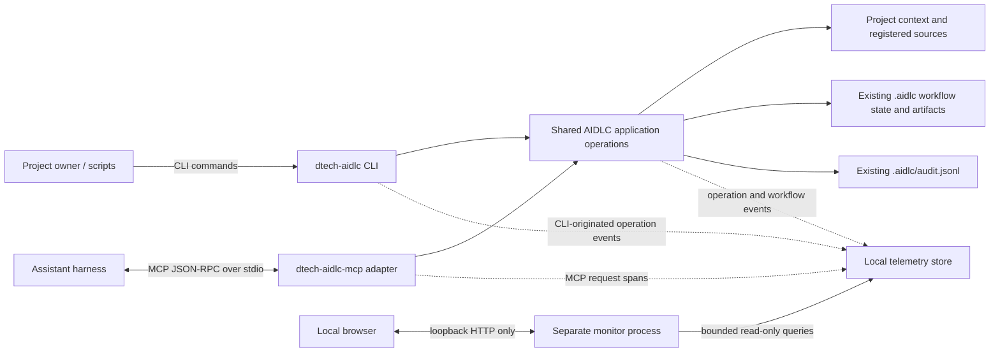
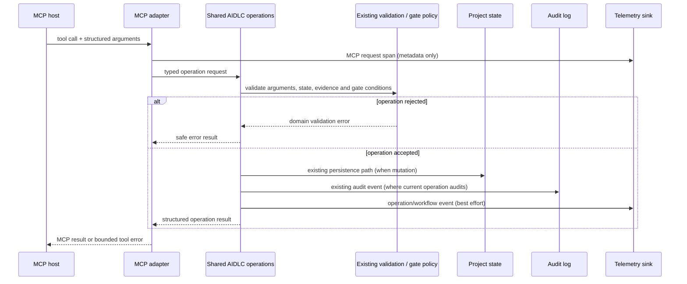

# dtech-aidlc MCP Server — Architecture Design

- **Status:** Proposed architecture; no MCP server, telemetry pipeline, or dashboard is currently implemented.
- **Date:** 2026-11-27
- **Related documents:** [Implementation plan](mcp-server-observability-implementation-plan.md) · [Detailed design](mcp-server-detailed-design.md)
- **Decision intent:** Add an optional local MCP entry point and local read-only observability dashboard without replacing the CLI or duplicating the workflow engine.

---

## 1. Context

`dtech-aidlc` is a local-first Rust workflow engine. Its CLI selects stages, owns workflow state, validates reports, enforces configured phase gates, and appends an audit log. Assistant harnesses currently work with the CLI through projected slash-command skills. MCP is a proposed additional way for MCP-capable harnesses to discover and call a narrow set of structured operations.

The intended architecture has two interface paths:

- **CLI path:** people and scripts invoke `dtech-aidlc` directly.
- **MCP path:** an assistant host starts `dtech-aidlc-mcp` locally and exchanges MCP messages over stdio.

Both paths should converge on the same application behavior. MCP should not shell out to the CLI, parse its formatted stdout, or become a second workflow engine. A separate, optional local dashboard should help operators inspect MCP requests and AIDLC workflow events without being able to change project state.

## 2. Current baseline and verified seams

The current crate is Rust, edition 2021, with `serde_json` and `sha2` as direct dependencies (`Cargo.toml`). The library at `rust-cli/lib.rs` exposes domain modules, including `orchestrate`, `status`, `audit`, `workflow`, `unit_commands`, and `work_units`.

Relevant current APIs and constraints:

- The CLI router and adapter behavior are in `rust-cli/main.rs`. It parses arguments, resolves `--project`/current directory, calls the state-directory safety check, and dispatches handlers (`main.rs:22-31`, `95-129`). Some operation setup remains in this binary (`run_read_only`, `run_orchestrate`, and `run_unit_queue`).
- Orchestration already has library-callable functions and request/result types: `orchestrate_next`, `orchestrate_report_with_engine`, `NextOptions`, `ReportOptions`, and `NextOutcome` (`rust-cli/orchestrate.rs:230-273`, `1142-1148`, `2793-2811`).
- Read-only status is available through `status::status`; work-unit queue/park/revisit behavior lives in `unit_commands::run` (`rust-cli/status.rs`, `rust-cli/unit_commands.rs:41-55`).
- State writes check that pointer and intent bytes have not changed and use an atomic save path (`orchestrate.rs:1071-1109`). Existing operations preflight and append `.aidlc/audit.jsonl` (`rust-cli/audit.rs:98-117`, `153-193`).
- The current audit log is durable workflow audit data. It is not telemetry, traces, or a live dashboard feed.
- Gate approver attribution is resolved from an explicit CLI value, Git `user.name`, or OS username (then `unknown`); none is authenticated identity. Existing human and AI gate modes have different rules. The proposed MCP v1 must not submit an approved decision for a human-mode gate; the owner completes that approval through the existing direct CLI path. AI-mode decisions remain subject to the existing recommendation/open-item policy.
- Existing CLI behavior is guarded by Rust unit/integration tests and golden snapshots. `Cargo.lock` supports locked builds; the repository does not currently declare `rust-version`, and a locked build is not inherently offline. Set an MSRV and evaluate offline-cache requirements explicitly before selecting dependencies.

All MCP, telemetry and dashboard components below are proposals, not current features.

## 3. Goals

1. Provide a local stdio MCP server for selected AIDLC operations.
2. Keep `dtech-aidlc` complete, useful, and installable without configuring MCP.
3. Centralize behavior behind library-level application operations shared by CLI and MCP.
4. Preserve project files, state schema, gate rules, safe-path checks, concurrency behavior and audit semantics.
5. Add metadata-only telemetry at both the MCP boundary and shared operation layer.
6. Provide a separately started, read-only local dashboard over telemetry.
7. Make telemetry best-effort, bounded, privacy-minimized, and distinct from workflow audit.

## 4. Non-goals

- Replacing or deprecating the CLI.
- Running MCP as a network-accessible service or adding a cloud relay.
- Giving the assistant general shell, Git, or arbitrary filesystem access.
- Creating a second workflow state store or changing the phase graph/intent-state schema for the first release.
- Treating the dashboard as a workflow control panel, approval authority, or audit log.
- Collecting prompts, raw tool arguments/results, artifact contents, credentials, or full absolute project paths.
- Shipping a hosted telemetry exporter in the initial release.

## 5. System context and component design

### Components and responsibilities

| Component | Responsibility | Must not do |
|---|---|---|
| Assistant harness | Starts MCP process and presents tool results/approval UX supported by the host. | Treat model-generated arguments as authorization. |
| MCP adapter | MCP handshake, tool discovery/calls, schema validation, request/result/error mapping, MCP spans. | Own workflow policy, write state directly, run arbitrary shell, or write diagnostics to protocol stdout. |
| CLI adapter | Preserve argument parsing, command surface, output formatting, exit codes and scripting experience. | Require an MCP host or route all commands through MCP. |
| Shared application layer | Project context, operation dispatch, domain validation, gate checks, persistence, existing audit behavior, shared telemetry hooks. | Duplicate lifecycle logic across adapters. |
| Project workspace | Authoritative project context, `.aidlc/` state, artifacts, config and audit. | Be mirrored into an independent workflow database. |
| Telemetry store | Bounded local operational events, separate from audit. | Authorize, mutate, or become evidence that a phase gate passed. |
| Monitor/dashboard | Read-only query and visualization of telemetry, launched by the proposed `dtech-aidlc monitor` subcommand as a separate process; loopback-only HTTP with strict Host/Origin checks and a per-run access-token decision. | Invoke AIDLC tools, modify telemetry/state, or expose remote endpoints. |

## 6. Boundaries and data flow

### 6.1 MCP request path

1. MCP host starts the server in the selected project context.
2. MCP host and process negotiate protocol over stdin/stdout.
3. Host calls a named bounded tool; server validates schema and limits.
4. Adapter invokes a library-level application operation.
5. Application logic reads local project data or performs the existing validated state transition.
6. Existing audit behavior continues for audited workflow changes. Shared-layer telemetry and MCP request telemetry are emitted independently.
7. Structured result/error returns through MCP. Telemetry is written through a separate local sink, never to stdout.

### 6.2 CLI request path

The CLI remains a separate direct entry point. Gradually move the operation setup now in `main.rs` behind the application façade. CLI calls that reach shared operations can emit operation-level telemetry. They do not acquire MCP spans. Any legacy handler that continues to bypass the shared façade has a documented telemetry coverage gap until refactored.

### 6.3 Mutation and approval path

Diagram is conceptual: existing operations determine the exact ordering of preflight, persistence, and audit per command. MCP must call those operations rather than reimplementing the sequence.

## 7. Observability architecture

Two event layers serve different questions:

- **Audit/log layer:** Existing `.aidlc/audit.jsonl` is the workflow audit record. Telemetry must not replace it or be presented as evidence that a gate decision was authentic or complete.
- **Integrity boundary:** The proposed JSONL telemetry store is best-effort and may be incomplete, truncated, or locally modified. If stronger tamper evidence or completeness is required, design that separately (for example, chained integrity metadata and protected checkpoints); do not imply it is supplied by ordinary local telemetry files.
- **Retention/visibility:** Telemetry may include validated intent, stage, unit, trace, and session identifiers. The monitor must disclose the effective collection setting and retention policy; default and exact limits remain release decisions.

- **MCP spans:** tool name, request/response timing, protocol outcome, safe error code, and correlation identifiers. Only calls through MCP are represented.
- **Shared operation/workflow events:** operation start/end and selected lifecycle transitions, emitted from shared code. These can cover both MCP and CLI paths once both call that code.

Telemetry is separate from `.aidlc/audit.jsonl`. The audit log remains the existing workflow audit record; telemetry is operational and best-effort. The dashboard displays coverage honestly: “no MCP span” does not mean no CLI activity, missing events do not mean a healthy workflow, and emitted transition events are not an exhaustive mirror of audit rows.

Initial deployment is local only:

- MCP uses stdio and opens no listener.
- Telemetry is stored below a dedicated ignored `.aidlc/telemetry/` directory, subject to safe-path validation and bounded retention.
- Dashboard is a separate process launched by the proposed `dtech-aidlc monitor` CLI subcommand, binding to loopback only on an ephemeral port. It reads recognized telemetry data and has no workflow mutation endpoint. Strict Host/Origin checks and a per-run read-token/access model are mandatory design gates.
- No remote telemetry exporter is included in v1.

## 8. Trust, privacy and security boundaries

- MCP arguments/results and project documents are untrusted input/data. Validate every tool argument and continue using current safe-path and workflow validation.
- Select project root at server launch; do not let each tool call select an arbitrary path.
- Keep protocol stdout clean. Diagnostics go to stderr; telemetry goes to the dedicated sink.
- Never place raw prompt text, tool arguments, results, artifact bodies, secrets, environment values, or unredacted absolute paths in telemetry.
- Dashboard is read-only, loopback-bound, bounded, and resistant to path traversal and symlink following. Apply strict Host/Origin checks, no permissive CORS, and an access-control mechanism chosen after local-process/browser threat review.
- Dashboard visibility does not grant write permission. Approval values remain governed by current AIDLC rules and their self-asserted identity limitation.
- Telemetry failures must not change operation results, persist partial workflow state, or corrupt MCP/CLI output.

## 9. Architectural decisions and open gates

| Decision | Proposed direction | Gate before implementation |
|---|---|---|
| MCP transport | Local stdio only | Confirm v1 scope; no remote transport. |
| Behavioral reuse | Shared application façade called by both adapters | Approve incremental CLI extraction boundaries. |
| MCP scope | Status, queue, next, report, with read/mutation labels | Approve exact schemas and side effects in detail design. |
| Workflow state | Existing project files and `.aidlc/` | No new workflow database. |
| Audit vs telemetry | Keep separate stores/schemas/roles | Privacy and semantics review. |
| Telemetry default | Proposed enabled for safe metadata with explicit opt-out; disabled-by-default remains an alternative | Owner privacy decision before release. |
| Dashboard host | `dtech-aidlc monitor` launches a separate, read-only loopback HTTP process | Security review requires strict Host/Origin checks and a chosen per-run access-control/bootstrap model. |
| MCP Rust SDK | Not selected | Dependency spike must prove maintenance, license, protocol support, selected MSRV, Windows support, and `--locked` reproducibility; validate offline-cache availability separately if required. |
| Approver identity | Preserve current caller-supplied identity contract | No claim of authenticated approvals. |

## 10. Quality attributes

- **Compatibility:** Existing CLI output, flags, exit codes, file formats and golden tests remain stable.
- **Safety:** No new path access beyond the selected project; mutations reuse current workflow checks.
- **Availability:** MCP/monitor are optional. Their failures do not prevent using the CLI.
- **Privacy:** Telemetry is local, bounded and field-allowlisted by default.
- **Observability correctness:** MCP and shared-operation coverage are distinguished; dashboard shows data freshness and gaps.
- **Portability:** Windows and POSIX behavior is tested; packaging installs both binaries without requiring a repository checkout.

## 11. Architecture acceptance criteria

1. MCP is an optional adapter; CLI remains independently operable.
2. MCP does not invoke the CLI as a subprocess or own workflow transitions.
3. Both adapters call shared operations for the supported scope.
4. MCP stdout is protocol-only; stdio server opens no network listener.
5. Existing safe-path, persistence/concurrency, audit and gate behavior is preserved.
6. Telemetry is distinct from audit, best-effort, bounded, and does not collect sensitive payloads.
7. Dashboard is separate, read-only, local-only and accurately describes coverage.
8. SDK/dependency, telemetry-default and local dashboard access decisions are resolved before release implementation.
